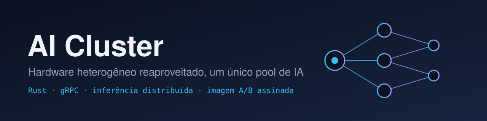
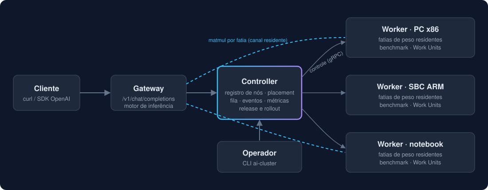
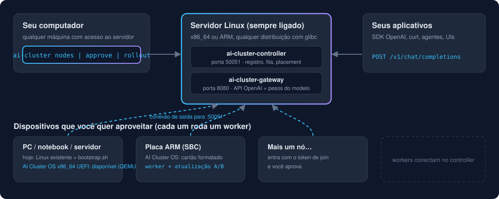
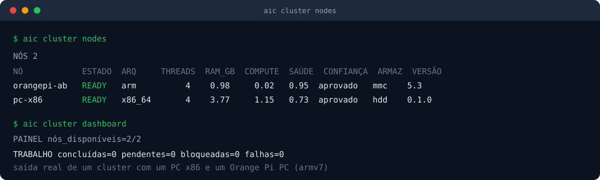
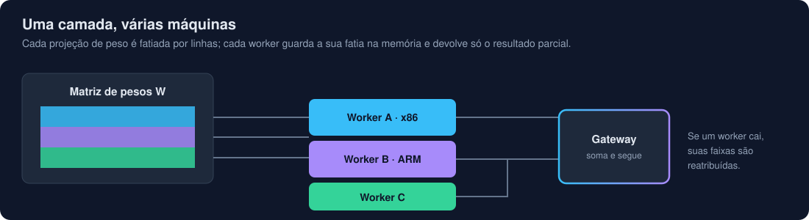
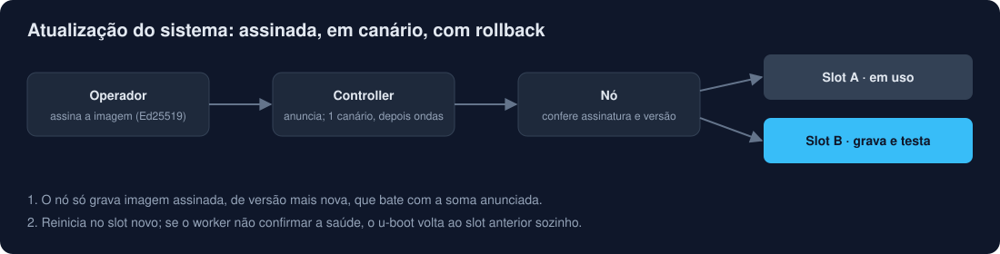

<p align="center">
  
</p>

<p align="center">
  <a href="https://github.com/julianscunha/Real.AI.Cluster/actions/workflows/rust.yml"></a>
  <a href="LICENSE"></a>
  
  
  
  <a href="SECURITY.md"></a>
</p>

[English](README.en.md) · **Português**

# AI Cluster

**Transforme as máquinas paradas que você já tem (PCs velhos, notebooks, servidores, Raspberry/Orange Pi) em um único pool de computação para IA.**

Cada uma é fraca; juntas rodam um modelo. Você baixa um modelo em **GGUF**, coloca numa pasta e roda `aic cluster model start`: o controller confere se a **memória somada** dos workers comporta o modelo (e diz o que falta, se não), escolhe quais máquinas o carregam, divide as camadas entre elas e entrega a **chave de API**. Quando uma máquina nova entra, ele refaz o plano sozinho. Sem GPU, sem configurar nó a nó. A execução é do [llama.cpp](https://github.com/ggml-org/llama.cpp) (centenas de arquiteturas, pesos quantizados, x86 e ARM); o AI Cluster cuida de admitir os nós com segurança, medir o que cada um aguenta, dividir o modelo e continuar funcionando quando uma máquina cai. Escrito em Rust, com API compatível com OpenAI.

```bash
aic cluster model list            # os modelos GGUF da pasta
aic cluster model check qwen2.5-7b-q4.gguf   # cabe? OK, ou NOK com o que falta
aic cluster model start qwen2.5-7b-q4.gguf   # carrega e mostra a chave de API (uma vez)
aic cluster model status          # estado, workers do plano e tokens/s medidos
```

<p align="center">
  
</p>

## Como funciona na prática

O AI Cluster é um sistema Linux com **papéis**. Você escolhe onde cada um roda:

<p align="center">
  
</p>

| Papel | O que é | Onde roda | Quantos |
|---|---|---|---|
| **Controller** | Cérebro do cluster: registra os nós, distribui o trabalho, guarda estado e métricas. | Um servidor Linux que fica sempre ligado. | 1 |
| **Worker** | Executa o trabalho e guarda as fatias do modelo na memória. | **Cada dispositivo que você quer aproveitar**: PC, notebook, servidor, placa ARM. | quantos você tiver |
| **Gateway** | A API (`/v1/chat/completions`, compatível com OpenAI) que seus aplicativos chamam. | No mesmo servidor do controller (ou em outro Linux com acesso a ele). | 1 |
| **Comando `aic`** | Como você administra e monitora o cluster (`aic cluster …`) e atualiza cada máquina (`aic update`). | Seu computador, ou o próprio servidor. | — |

Fluxo de uso:

0. **Só para experimentar**, tudo em um computador com Docker: veja o [início rápido](#início-rápido-em-um-computador-docker).
1. **Instale o controller** no servidor e anote os dois tokens (join e operador).
2. **Transforme cada dispositivo em worker.** O caminho do projeto é o **AI Cluster OS**: um sistema próprio, imutável e enxuto que **substitui o sistema do dispositivo** (ele é formatado) e o deixa dedicado a ser worker, com atualização assinada e rollback automático. Hoje a imagem existe para **placas ARMv7** (testada em hardware) e para **PCs x86_64 UEFI** (validada em QEMU, ainda não em hardware real); para **ARM64 ainda não existe**. Nos casos sem imagem o worker pode ser instalado sobre o Linux que o dispositivo já tem (caminho de transição, sem formatar).
3. **Aprove** cada nó novo e **monitore** tudo pela CLI.
4. **Ponha um modelo GGUF na pasta do controller e rode `aic cluster model start`** (passo 5). Aponte seus aplicativos para o gateway com a chave que ele mostrar.

## Pré-requisitos

| Onde | Precisa de |
|---|---|
| **Servidor do controller/gateway** | Linux x86_64 (glibc), acesso de rede dos workers à porta `50051` e dos clientes à `8080`. O gateway é o nó principal do modelo (roda o `llama-server`): precisa de RAM para as camadas que ficarem com ele e para o contexto. |
| **Cada worker** | **AI Cluster OS** (placa ARMv7 ou PC x86_64 UEFI: o disco é apagado e regravado) **ou** um Linux x86_64/ARMv7/ARM64 já instalado com `root` e, de preferência, systemd. Nos dois casos: conexão de saída até a porta `50051` do controller e memória livre para a fatia do modelo. |
| **Máquina de build** (uma vez) | Linux com Rust estável ≥ 1.85 (`rustup`). Compila os binários; servidores e dispositivos não precisam de Rust. Para gerar binário ARMv7 a partir de x86, Docker nessa máquina. |
| **Seu computador** | O comando `aic` e acesso de rede ao controller. |
| **Modelos** | Arquivos **GGUF** (a maioria dos modelos abertos tem uma versão quantizada), numa pasta que o controller e o gateway enxerguem. Sem modelo o cluster funciona, só não responde chat. |
| **Catálogo de modelos** | Modelos de pesos abertos, do mais simples ao mais avançado, com notas, RAM estimada, link de download e quais já foram homologados: [`docs/guia/modelos.md`](docs/guia/modelos.md). |

Docker **não** é requisito para usar o AI Cluster. Ele só aparece para quem desenvolve o projeto (veja o fim deste README).

## Início rápido em um computador (Docker)

Para experimentar o fluxo inteiro sem montar nada à mão (precisa de Docker, bash e openssl):

```bash
bash deploy/init.sh                                    # gera tokens e certificados (uma vez)
cp meu-modelo.gguf deploy/models/                      # qualquer modelo em GGUF
docker compose -f deploy/docker-compose.yml up -d --build --scale worker=2
docker compose -f deploy/docker-compose.yml exec controller aic cluster model list
docker compose -f deploy/docker-compose.yml exec controller aic cluster model start meu-modelo.gguf
docker compose -f deploy/docker-compose.yml exec controller aic cluster model status
```

O `aic cluster model start` confere a RAM dos workers, divide o modelo entre eles e mostra a chave de API (uma vez).
Depois é só chamar `POST http://localhost:8080/v1/chat/completions` com `Authorization: Bearer <chave>`.
Veja [os modelos e as notas](docs/guia/modelos.md) e, para workers em outras máquinas,
[a instalação](docs/guia/instalacao.md).

## Instalação guiada (Linux)

```bash
curl -fsSL https://github.com/julianscunha/Real.AI.Cluster/releases/latest/download/install.sh | sudo sh
```

O instalador explica os 3 componentes (controller, gateway e worker), pergunta o que cada computador será e qual é o processador (x86_64 ou ARM de 32 bits), e baixa da última release só o que esse papel precisa. Em inglês, acrescente `-s -- --lang en` ao `sh`.

Depois da instalação, o comando é o `aic`. Ele cobre tudo: `aic cluster …` (o cluster visto do controller), `aic controller|gateway|worker status` (esta máquina), `aic update` e `aic version`. A referência completa está em [a CLI](docs/guia/cli.md).

### Dois computadores

1. **No servidor:** escolha *Controller* (com o gateway junto, o mais simples). Depois rode `sudo aic cluster invite`: ele mostra um **código de 8 caracteres** e a linha para os outros computadores entrarem.
2. **No segundo computador:** rode a linha do convite (`curl -fsSL http://<ip-do-servidor>:8099/join-<CÓDIGO> | sudo sh`) e escolha *Worker*. Sem o código ninguém entra.
3. **De volta ao servidor:** `aic cluster nodes` mostra o nó pendente; `aic cluster node approve <id> --fingerprint <impressão>` aprova. Só nó aprovado recebe trabalho.
4. `aic cluster model start <arquivo.gguf>` sobe o modelo e mostra a chave de API. A API fica em `http://<ip>:8080`.

Num computador com Linux que vai virar AI Cluster OS dedicado, o convite mostra também `curl -fsSL http://<ip>:8099/wait | sudo sh`: o aparelho se apresenta com uma impressão digital, e **nada é instalado nem apagado até você aprovar** com `aic cluster install approve`. Detalhes, limites e o modo dedicado em [a instalação](docs/guia/instalacao.md). O passo a passo manual abaixo continua valendo para quem quer controlar cada peça.

### Atualizar e serviços no boot

- `aic update status` mostra a versão instalada e a disponível; `sudo aic update apply` atualiza este computador (controller, gateway ou worker em Linux). Em Linux, a atualização confere a assinatura da release com a chave de Linux, gravada na instalação.
- No AI Cluster OS e nos workers em Linux comum, o controller empurra a release assinada. `aic cluster nodes` mostra a `VERSÃO` de cada nó, para ver quem está para trás.
- Os serviços sobem sozinhos ao ligar o computador (systemd, com reinício automático). Em contêiner sem systemd, eles não voltam sozinhos depois de reiniciar o contêiner. O que cada componente faz no `aic update` está em [a operação](docs/guia/operacao.md).

## Instalação passo a passo

### 1. Compile os binários (uma vez)

Em uma máquina Linux de build:

```bash
git clone https://github.com/julianscunha/Real.AI.Cluster.git
cd Real.AI.Cluster/code
cargo build --release --workspace
# binários em target/release/: ai-cluster-controller, ai-cluster-gateway, ai-cluster-worker, aic
```

Copie `ai-cluster-controller` e `ai-cluster-gateway` para o servidor, `aic` para quem vai administrar e `ai-cluster-worker` para cada dispositivo **da mesma arquitetura**. Para placas ARMv7 compile com `TARGET=armv7-unknown-linux-musleabihf bash scripts/build-armv7.sh` (veja o [guia de instalação](docs/guia/instalacao.md)). Para x86_64 há um pacote pronto na [release v0.2.0](https://github.com/julianscunha/Real.AI.Cluster/releases/tag/v0.2.0).

### 2. Controller (no servidor)

```bash
export AI_CLUSTER_JOIN_TOKEN=$(openssl rand -hex 24)       # os workers usam para entrar
export AI_CLUSTER_OPERATOR_TOKEN=$(openssl rand -hex 24)   # você usa para administrar
echo "join=$AI_CLUSTER_JOIN_TOKEN operador=$AI_CLUSTER_OPERATOR_TOKEN"   # guarde os dois

mkdir -p /var/lib/aic
AI_CLUSTER_INSECURE=1 \
AI_CLUSTER_NODES=/var/lib/aic/nodes AI_CLUSTER_STATE=/var/lib/aic/state.bin AI_CLUSTER_EVENTS=/var/lib/aic/events.log \
./ai-cluster-controller        # escuta em 0.0.0.0:50051
```

> `AI_CLUSTER_INSECURE=1` desliga o TLS: use só em rede local confiável. Em qualquer outra rede configure o TLS (certificado do controller e `AI_CLUSTER_TLS_CA` nos workers): [`docs/guia/instalacao.md`](docs/guia/instalacao.md#produção-com-tls). `aic controller install` já instala o controller como serviço do systemd; rodar à mão, como acima, serve para entender cada peça.

### 3. Worker (em cada dispositivo)

**Caminho recomendado: AI Cluster OS (placas ARMv7).** O dispositivo é formatado e passa a rodar o sistema do projeto, já com o worker, o controller configurado e atualização A/B assinada. Veja o passo 6.

**Caminho de transição: worker sobre o Linux existente.** Serve a ARM64 (ainda sem imagem) e a quem ainda não quer formatar o PC (a imagem x86_64 é recente e só foi validada em QEMU). Nada é formatado, e o dispositivo continua um Linux comum: sem atualização A/B nem rollback de boot. Copie `ai-cluster-worker`, `code/os/bootstrap.sh` e o token de join para o dispositivo e, como root:

```bash
echo '<token-de-join>' > /root/join-token && chmod 600 /root/join-token
sudo ./bootstrap.sh --controller http://<ip-do-servidor>:50051 --insecure \
  --token-file /root/join-token --binary ./ai-cluster-worker --node-id sala-pc1
```

O script cria o usuário, instala o worker como serviço do systemd e confirma que ele se registrou. (`--insecure` só porque o exemplo usa `http://`; com TLS use `https://` e a CA.)

### 4. Aprove e monitore (CLI)

```bash
export AI_CLUSTER_CONTROLLER=http://<ip-do-servidor>:50051 AI_CLUSTER_OPERATOR_TOKEN=<token-de-operador>
aic cluster nodes             # o nó novo aparece, pendente
aic cluster node approve sala-pc1 --fingerprint <impressão>  # só nós aprovados recebem trabalho
aic cluster dashboard --watch 2
aic cluster events            # entradas, saídas, falhas
```

<p align="center">
  
</p>

### 5. Modelo, gateway e API

Cada worker que vai dividir modelos roda o `ggml-rpc-server` do llama.cpp **atrás de um túnel mTLS** (o servidor RPC não tem senha, então nunca fica exposto): na imagem ARMv7 ele já vem e liga sozinho quando existem os certificados em `/data/rpc-tls`; em um Linux comum use `bootstrap.sh --rpc-server-bin ... --rpc-tls-dir ...`. O gateway recebe o `llama-server`, a pasta de modelos e os certificados ([`docs/guia/configuracao.md`](docs/guia/configuracao.md)). Depois:

```bash
aic cluster model list                       # coluna ROD: o motor roda este modelo
aic cluster model check meu-modelo.gguf      # soma a RAM dos workers; NOK diz quanto falta
aic cluster model start meu-modelo.gguf      # plano, carga e a chave de API (uma vez)
aic cluster model status                     # CARREGANDO, PRONTO; workers do plano; tokens/s
```

```bash
curl http://<ip-do-servidor>:8080/v1/chat/completions \
  -H "Authorization: Bearer <chave-que-o-start-mostrou>" -H "Content-Type: application/json" \
  -d '{"model":"meu-modelo","messages":[{"role":"user","content":"Hello!"}],"max_tokens":64}'
```

**Como o controller decide:** os workers mais rápidos primeiro, **só até a RAM somada comportar o modelo**. Cada worker que entra soma um salto de rede por palavra, então um lento (um Pi ao lado de um PC) só participa quando faltaria memória; com o modelo cabendo no PC, o Pi o faria perder cerca de 5 vezes a velocidade (medido). Entre os escolhidos, a divisão de camadas é proporcional à velocidade e limitada pela RAM de cada um. Um worker novo muda o plano só se mudar esse conjunto, depois de 30 s estável. Se a RAM deixa de bastar, o modelo para com o motivo e volta sozinho quando ela volta.

**Chaves de API:** uma por tenant, com modelos, cota e classe de prioridade (`aic cluster model key add|rotate|remove|list`). O controller guarda só o hash. **Várias vagas** (`AI_CLUSTER_LLAMA_SLOTS`) atendem mais pedidos ao mesmo tempo: no laboratório, 2 pedidos juntos deram 34% mais tokens por segundo no total.

**Admissão e operação em casa:** `aic cluster model check` conta o cache de contexto por vaga, a memória do gateway (128 MiB mais 30% dos pesos) e se o modelo sobrevive à perda de um worker; pedir o nome da família escolhe a variante mais precisa que cabe. Se um worker cai, o gateway espera a recarga (até 120 s) e refaz o pedido uma vez. Workers com disco rápido ligam sozinhos o cache de tensores do `rpc-server` (a 2ª carga no Orange Pi levou 42 s, contra 51 a 67 s sem cache). Para um Linux x86_64, `code/scripts/package-worker.sh` gera um pacote com worker, `rpc-server` e `install.sh`. O controller grava o estado sem passar de ~10% do tempo e grava ao receber SIGTERM. Resistência medida: 60 min de carga com partição de rede e reinícios do controller, 14.432 unidades sem falha e memória estável.

<p align="center">
  
</p>

O **motor próprio** (GPT-2 e SmolLM2 em safetensors, com as projeções fatiadas entre os workers) continua disponível como referência de paridade; veja [`docs/guia/api.md`](docs/guia/api.md). Todas as variáveis, tenants, cotas e a API: [`docs/guia/configuracao.md`](docs/guia/configuracao.md).

### 6. AI Cluster OS: o dispositivo vira um worker dedicado

O **AI Cluster OS** é o destino do projeto para qualquer dispositivo: uma imagem Alpine imutável, com dois slots (A/B), que apaga o sistema anterior e deixa a máquina só com o que um worker precisa. O operador assina a atualização; o controller a anuncia, um nó canário atualiza primeiro e os demais seguem em ondas. Se o nó novo não ficar saudável, o boot volta ao slot anterior sozinho.

**Disponibilidade hoje:** placas **ARMv7** (testado em Orange Pi PC) e PCs **x86_64 UEFI** (validado em QEMU com OVMF, falta testar em hardware real; exige Secure Boot desligado; veja o [guia](docs/guia/instalacao.md#imagem-do-ai-cluster-os-x86_64-uefi)). **Ainda não existe imagem para ARM64**, que é o próximo passo do projeto (veja [`pendencias.md`](docs/implementation/pendencias.md)). Até lá, desktops e servidores usam o caminho de transição do passo 3.

<p align="center">
  
</p>

Gerar a imagem, gravar o cartão e publicar releases: [`docs/guia/instalacao.md`](docs/guia/instalacao.md) e [`docs/guia/operacao.md`](docs/guia/operacao.md).

## O que você ganha

- **Um comando põe o modelo no ar:** `aic cluster model start` confere a RAM, escolhe os workers, divide as camadas, carrega e entrega a chave de API. Sem variável por modelo nem cópia de pesos para cada nó.
- **Diz "não cabe" antes de tentar:** o `aic cluster model check` soma a RAM dos workers e responde OK ou NOK com o que falta e quantos nós acrescentar. Mais máquinas, mais modelo: sem teto de tamanho além da memória somada.
- **Escolhe os workers certos:** rápidos primeiro, lentos só quando a RAM exige; a divisão de camadas segue a velocidade de cada nó e o limite da memória dele.
- **Modelos quantizados e centenas de arquiteturas** (GGUF, pelo llama.cpp), em x86_64 e em ARMv7 de 1 GB, sem GPU obrigatória. O Orange Pi PC roda um modelo de 360M a 2,6 tokens/s sozinho e um de 1,5B dividido com um PC.
- **Worker novo entra sozinho:** o plano se refaz, o modelo recarrega e o benchmark é medido de novo.
- **Mais pedidos ao mesmo tempo:** várias vagas por modelo, com fila por classe de prioridade.
- **Chaves de API por tenant:** modelos, cota e classe por chave; rotação e remoção; só o hash fica guardado.
- **Nós entram e saem sem cerimônia:** join com token, aprovação conferida pela impressão digital da credencial, drain, saída limpa, quarentena automática de nó que erra.
- **Segurança por papéis:** credenciais separadas para entrar, operar e inferir; TLS e mTLS; o gateway roda sem o token de operador. O `rpc-server` do llama.cpp, que não tem senha, só atende por um túnel mTLS com papel de gateway.
- **Atualização segura do sistema:** release assinada (Ed25519), canário, ondas e rollback automático.
- **Observável:** métricas Prometheus em `:9101`, eventos, traces de requisição e painel no terminal.

## Estado do projeto

Pré-produção: o núcleo (cluster, placement por velocidade e RAM, modelos GGUF divididos entre máquinas, segurança por papéis, imagem A/B com release assinada) roda e é testado em PC x86 e Orange Pi (ARMv7). Medidas reais e a decisão por trás de cada escolha estão no [ADR-022](docs/system/05-decisoes/adr-022-fluxo-de-modelos-e-motor-hibrido.md). O que ainda falta está em [`docs/implementation/pendencias.md`](docs/implementation/pendencias.md): certificado do túnel por nó, aceleradores (GPU/NPU), worker móvel, revogação de chave e *attestation* por hardware, entre outros.

**Limites que valem saber:** um worker lento limita a velocidade de todos os pedidos que passam por ele, então o ganho de um cluster aparece quando o modelo **não cabe em uma máquina só**; modelos grandes em hardware fraco geram poucas palavras por segundo; as notas do [catálogo](docs/guia/modelos.md) vêm das fichas oficiais e foram conferidas por amostragem.

## Documentação

| Para | Veja |
|---|---|
| Instalar, configurar e operar | [`docs/guia/`](docs/guia/guia.md) |
| Entender como funciona e como é estruturado | [`docs/system/`](docs/system/system.md) (arquitetura, protocolo, modelo de dados, decisões) |
| Contribuir com código | [`CONTRIBUTING.md`](CONTRIBUTING.md) e [`AGENTS.md`](AGENTS.md) |

## Estrutura do repositório

```
code/
  crates/{common,protocol,controller,worker,transport,benchmark,cli,engine,gateway,catalog,tunnel}
  proto/cluster.proto      contrato de comunicação (ai.cluster.v1)
  os/                      bootstrap.sh, imagem A/B, netboot, instalador
  third_party/llama.cpp/   patch para nós de 32 bits e script de build do llama.cpp
  scripts/ tests/          build ARM, cluster de desenvolvimento, testes de ponta a ponta
deploy/                    Docker Compose: Dockerfile único, init.sh (tokens e certificados)
docs/                      guia/, system/, implementation/ (pendências)
```

## Para quem desenvolve o projeto

Há um cluster de desenvolvimento em contêineres Docker, que roda tudo na sua máquina para testar mudanças. **Não é o jeito de usar o AI Cluster**: é ferramenta de desenvolvimento (sem TLS, tokens fixos).

```bash
cd code
bash scripts/dev-cluster.sh build && bash scripts/dev-cluster.sh up 2   # controller + 2 workers
bash scripts/dev-cluster.sh cli nodes
bash scripts/dev-cluster.sh gateway                                     # API em 127.0.0.1:8080, chave dev-key
bash scripts/dev-cluster.sh down
cargo test --workspace --all-features
```

Mais em [`CONTRIBUTING.md`](CONTRIBUTING.md) e [`docs/guia/testes.md`](docs/guia/testes.md).

## Contribua

Dê uma ⭐ se a ideia te interessa, abra uma issue com ideias ou problemas e leia o [`CONTRIBUTING.md`](CONTRIBUTING.md). Vulnerabilidades: [`SECURITY.md`](SECURITY.md) (relato privado, não abra issue). Conduta: [`CODE_OF_CONDUCT.md`](CODE_OF_CONDUCT.md).

Licença: [Apache-2.0](LICENSE).
